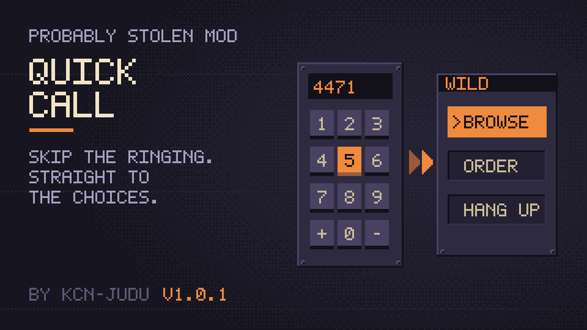

# Quick Call



A mod for *Probably Stolen*. Calls to Wild and your other contacts open on their choices. The mod removes the wait after the last digit, the ringing, the pickup pause and the greeting lines. Intro and story calls still play in full.

**Documentation:** <https://kcn-judu.github.io/ProbablyStolen-Mods/en/quick-call/> ([简体中文](https://kcn-judu.github.io/ProbablyStolen-Mods/zh-cn/quick-call/))

Part of the [Probably Stolen mods collection](https://github.com/KCN-judu/ProbablyStolen-Mods).

## Install

Subscribe on the [Steam Workshop](https://steamcommunity.com/sharedfiles/filedetails/?id=3832481274), or copy the folder from a [release](https://github.com/KCN-judu/ProbablyStolen-QuickCall/releases) into the game's `Mods` folder. Then enable the mod in the game's Mods menu and restart the game.

## Build

```bash
./build.sh            # out/quick_call
./build.sh --install  # also copies it to the game's Mods folder
```

See [Building](doc/manual/building.md) for the requirements and the `GAME` and `CSC` variables.

## Repository layout

| Path | Contents |
| --- | --- |
| `src/` | The mod's source |
| `tests/` | The test of the dialing rule, run outside the game |
| `build.sh` | Builds the mod into `out/quick_call` |
| `doc/manual/` | Documentation, in English (the source of every translation) |
| `doc/locale/` | Translations of the documentation, as gettext catalogs |
| `manifest.xml`, `preview.png` | What the game reads, next to the DLL |
| `WORKSHOP.txt` | The Steam Workshop description, in BBCode |
| `CHANGELOG.md` | Changes by version |

## License

[Apache License 2.0](LICENSE).
