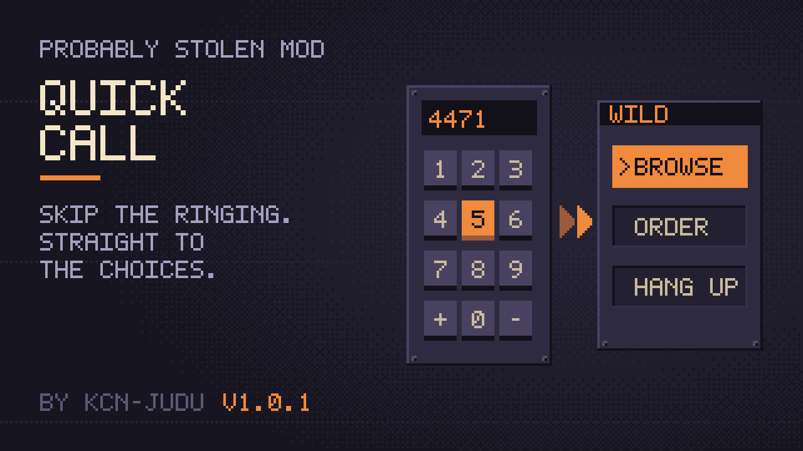

# Quick Call

Quick Call makes every call to Wild, a supplier or another contact open on its choices. It removes the waits before and after the call and the greeting lines.

## What it removes

- The 2.25 s wait after the last digit. A contact's number dials as soon as it is complete and no other contact's number starts with the same digits.
- The 1 to 5 s of ringing and the 1.5 s pickup pause. A number that doesn't answer shows "No Answer" at once.
- The greeting lines. Every call opens on the line with the choices.
- The pause before the choices appear. The first line shows in full and the choices appear with it.

## What stays

- Intro calls, cooldown replies and story calls play in full.
- Everything after you pick a choice works as before.
- The phone book's quick dial still works, and it also loses the pause before the choices.
